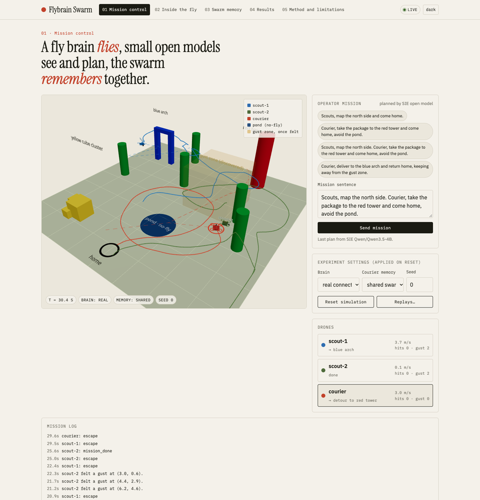
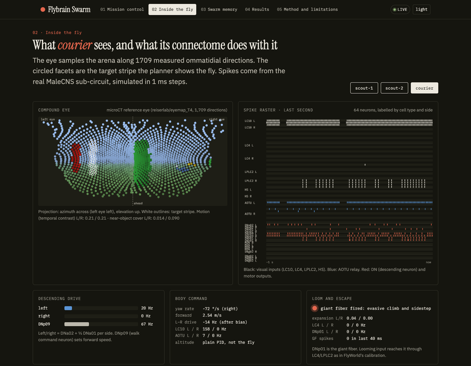
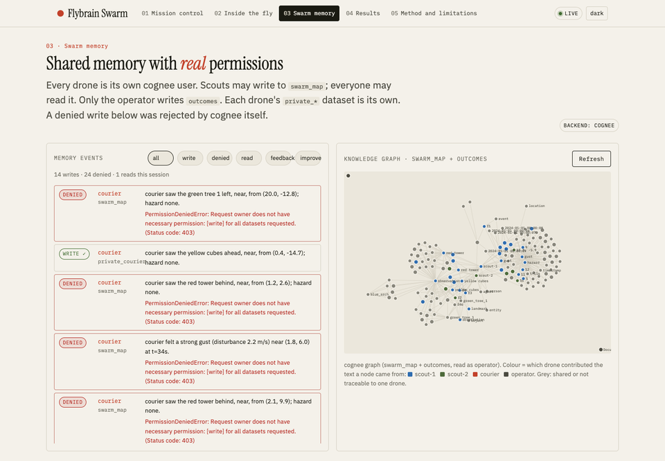
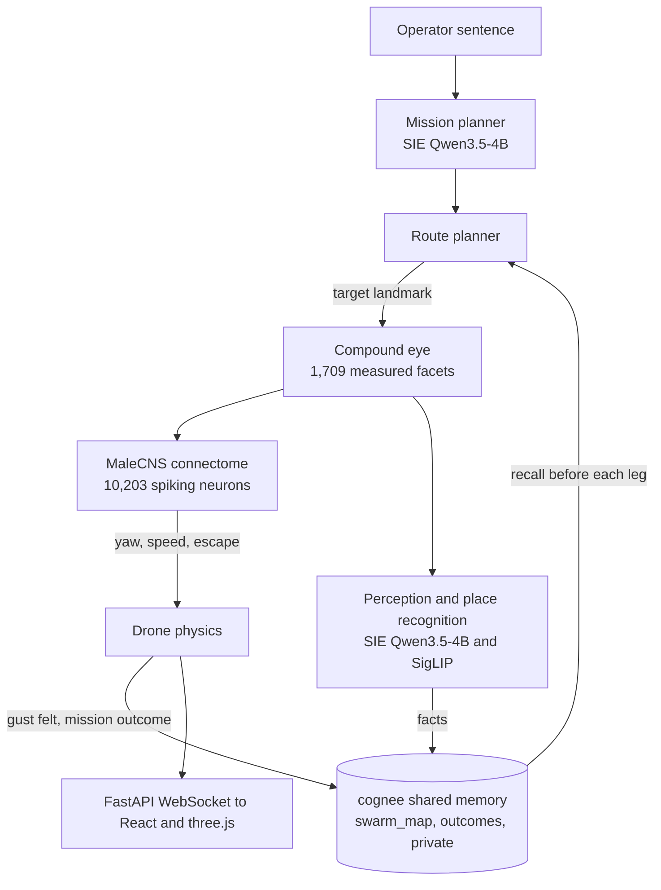

<h1 align="center">Flybrain Swarm</h1>

<p align="center"><em>A fly brain flies, small open models see and plan, and the swarm remembers together.</em></p>

<p align="center">
  <a href="https://flybrain-swarm.onrender.com/"><b>🌐 Open the live app</b></a> &nbsp;·&nbsp;
  <a href="fly_superlinked/README.md"><b>📖 Technical README</b></a>
</p>

Built on top of the [Flybrain](https://flybrain-q2h5.onrender.com/) research site.



---

## What it is

Three simulated drones (`scout-1`, `scout-2`, `courier`) fly a 40 × 40 m outdoor arena with landmarks, a no-fly pond and a **hidden gust zone** that no drone knows about at the start.

1. **They fly with a real fly brain.** Each drone is steered by a **10,203-neuron, 401,680-synapse-edge sub-circuit of the MaleCNS v1.0 fruit-fly connectome**. It is simulated as spiking leaky integrate-and-fire neurons in 1 ms steps. The pathway that does the steering is visual neurons (LC10) → AOTU → descending turn neurons (DNa02); the giant fiber (DNp01) triggers escapes from looming objects.
2. **They see through a real fly eye.** The compound eye is built from **1,709 measured ommatidial directions** (microCT of a real *Drosophila* eye), ray-cast against the arena in about 1 ms per frame.
3. **Their everyday jobs run on small open models (Superlinked SIE).**
   - Turning an operator's sentence into a flight plan.
   - Turning what a drone sees into facts.
   - Recognising places it has seen before.

   All three run on **Superlinked SIE Serverless** with `Qwen/Qwen3.5-4B` and `google/siglip2-base-patch16-224`, and are benchmarked against a frontier model (`claude-opus-5-5`).
4. **They share what they learn (cognee).**
   - Every drone is its own **cognee user with real read/write permissions**. Scouts can write to the shared map; the courier can only read it, and cognee itself rejects its writes with a 403.
   - After every mission, outcomes, corrections and feedback flow back into memory, and `cognee.improve()` runs.
   - cognee itself runs on SIE models, so the whole memory stack is open models.
5. **Everything has controls.**
   - Two degree-preserving **rewired connectomes** and a hand-written **reactive** controller fly the same seeds.
   - Memory is tested in three arms: none, private only, shared.
   - Results are reported as measured, including where the fly brain loses.

## Headline results

| Question | Answer |
|---|---|
| **Does shared memory help?** *(cognee)* | **Yes.** The courier flew into the hidden gust on **100%** of missions with no memory, **55%** with private notes only, and **15%** with the scouts' shared map. The detour costs about 2 s per mission. |
| **Can small open models do the everyday jobs?** *(Superlinked)* | **For planning, yes.** Qwen3.5-4B on SIE produced the exact gold plan on **87%** of 30 missions, against **97%** for Claude Opus 5.5, at **1/23 of the cost** ($0.36 vs $8.49 per 1,000 calls). For perception from 128×64 eye panoramas, **neither model is good** (8% vs 28% exact match). |
| **Does the real wiring matter?** | **Yes.** The real connectome completed **60%** of courier missions (95% delivered the package). Both rewired graphs completed **0%**. A hand-written reactive controller completed **100%**: the fly brain is not the best controller, and we say so. |
| **Why do rewired brains fail?** | In the real wiring, a target on the left drives the left DNa02 neuron, so the drone turns toward it. In the class-preserving shuffle this pathway is **mirrored**, so the drone turns away from its target. |

All numbers come from `fly_superlinked/backend/bench/results/*.json`; the README tables are generated from these files, never typed by hand.

## Where Superlinked and cognee come in

| Integration | Evidence |
|---|---|
| **cognee**: agents share what they learn | **Users and datasets.** One cognee user per drone plus `operator`. There are private datasets, a shared `swarm_map` that only scouts can write, and `outcomes` that only the operator writes. Permission denials come from cognee and appear live, in red, in the Swarm memory page.<br>**Learning loop** (`swarm.py` → `finish_mission`): write the outcome, correct wrong hazards, call `session.add_feedback`, run `improve()`.<br>**Ablation:** a 3-arm memory experiment over 20 seeds. |
| **Superlinked**: move an agent's everyday jobs off a frontier model | **One line per job:** `backend/models.yaml`.<br>**Reliable output:** strict JSON schemas, pydantic validation, one retry, then a loud failure.<br>**Measurement:** tokens, latency and cost for every call, and a side-by-side benchmark against Claude Opus 5.5 on 30 missions and 40 keyframes.<br>**cognee on SIE too:** its LLM (`Qwen/Qwen3.8-27B-FP8`) and embeddings (`BAAI/bge-m3`) also run on SIE. |

## The app (five pages)

| Page | What you see |
|---|---|
| **01 Mission control** | 3D arena, drones with trails and planned routes, the gust zone once a drone has felt it. There is a mission text box, plus brain / memory / seed selectors and a Live or Replay mode. |
| **02 Inside the fly** | For the selected drone: compound-eye mosaic, a spike raster of 64 labelled neurons, left/right descending drive, and a giant-fiber escape lamp. |
| **03 Swarm memory** | A live feed of every memory read and write (allowed or **denied**), plus cognee's knowledge graph coloured by which drone contributed each node. |
| **04 Results** | Controller comparison, memory ablation, and SIE vs frontier, read live from the bench files. |
| **05 Method** | What the connectome controls and what is engineered, the data sources, the circuit probe, and known limits. |

<table>
<tr>
<td width="50%"><b>02 Inside the fly</b><br></td>
<td width="50%"><b>03 Swarm memory</b><br></td>
</tr>
</table>

The Results page (controller comparison, memory ablation, SIE vs frontier) is shown in full in the [technical README](fly_superlinked/README.md#results).

## Try it

**In the browser:** open https://flybrain-swarm.onrender.com/.
1. Send *"Scouts, map the north side and come home."* The scouts find the gust and write it to the shared map.
2. Send *"Courier, take the package to the red tower and come home, avoid the pond."* The courier recalls the scouts' map and routes around the gust.

If the live sim is slow, switch to **Replay** on Mission control.

**Locally:**

```bash
git clone https://github.com/AUW160150/flybrain_superlinked && cd flybrain_superlinked/fly_superlinked
python3.12 -m venv .venv
.venv/bin/pip install torch==2.15.0 --index-url https://download.pytorch.org/whl/cpu
.venv/bin/pip install -r requirements.txt && .venv/bin/pip install --no-deps sie-sdk==0.11.0
cp .env.example .env            # add SIE_API_KEY (and optionally FRONTIER_API_KEY)
cd frontend && npm ci && npm run build && cd ..
.venv/bin/uvicorn backend.api.server:app --port 8000   # open http://localhost:8000
```

**Without an SIE key:** the app still runs, with a keyword planner and a local permissioned memory, and the UI says so. **Tests:** `.venv/bin/pytest -q` (23 tests).

## Architecture



**Stack:**
- **Backend:** Python 3.12, FastAPI, torch (CPU) and numpy.
- **AI services:** `sie-sdk` 0.11.0 for the open models, cognee 1.6.7 for memory, and the Anthropic SDK for the frontier comparison.
- **Frontend:** React 18, Vite 5, TypeScript, three.js with react-three-fiber, and d3-force.
- **Deploy:** a Docker service on Render.

## Repository map

```
flybrain_superlinked/
  README.md            this page
  render.yaml          Render blueprint (Docker web service, health check /healthz)
  fly_superlinked/
    README.md          full technical write-up: how it works, results tables, method and limits
    NOTES.md           what was reused from the flybrain research repo
    LOG.md             build log, including bugs found and fixed before the final runs
    GATES.md           completion checks used during the build
    backend/           sim/, brain/, agents/, memory/, api/, bench/, scripts/, tests/, replays/
    frontend/          five-page React app
    docs/img/          screenshots
```

## Credits

- **Connectome:** MaleCNS v1.0 (Berg et al., *Cell*, 2026; FlyEM at HHMI Janelia, University of Cambridge, MRC LMB, Google Research; CC BY 4.0).
- **Eye:** directions from `reiserlab/eyemap_T4`.
- **Brain simulation:** the FlyWorld circuit, LIF simulator and decoder come from `prove-ai/flybrain`.
- **Services:** open models served by **Superlinked SIE**; memory by **cognee**.
