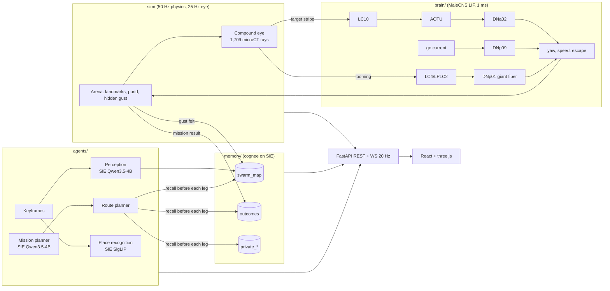

# Flybrain Swarm

*A fly brain flies, small open models see and plan, and the swarm remembers together.*

Three simulated drones (`scout-1`, `scout-2`, `courier`) fly an outdoor arena. Each drone sees through a compound eye built from 1,709 measured ommatidial directions of a real fruit fly. Each drone is steered by a 10,203-neuron sensory-to-descending sub-circuit of the **MaleCNS v1.0** connectome, simulated as leaky integrate-and-fire neurons in 1 ms steps. Routine agent jobs run on small open models through **Superlinked SIE Serverless**: turning an operator sentence into a JSON flight plan, turning what a drone sees into structured facts, and recognising places it has seen before. Their quality and cost are measured against a frontier model. The drones share what they learn through **cognee**. Every drone is its own cognee user with real read/write permissions. After each mission, outcomes, feedback and corrections flow back into memory. Every experiment includes a degree-preserving rewired connectome and a reactive baseline, and the results are reported as measured.

**Live: https://flybrain-swarm.onrender.com** (Render, Starter plan). Built for LOCALHOST NYC (7 November 2026) on top of the owner's [Flybrain](https://flybrain-q2h5.onrender.com/) research site.

## Which part targets which prize

| Prize | What to look at |
|---|---|
| **cognee**: agents share what they learn | `backend/memory/store.py`: one cognee user per drone plus `operator`. Datasets `private_<drone>`, `swarm_map` (scouts write, all read) and `outcomes` (operator writes, all read). Write denials are cognee's own `PermissionDeniedError`, shown live on the Swarm memory page. The learning loop in `backend/agents/swarm.py` (`finish_mission`, `_correct_hazards`) writes outcomes, corrections, session feedback and `improve()`. Ablation: `backend/bench/memory_ablation.py`. |
| **Superlinked**: move everyday jobs off a frontier model | `backend/models.yaml` (one line per job). `backend/agents/jobs.py` holds the planner and perception jobs with strict JSON schemas and pydantic validation, retried once, then failing loudly. `backend/agents/llm.py` measures tokens and cost for SIE and the frontier model. cognee itself runs on SIE (LLM `Qwen/Qwen3.8-27B-FP8`, embeddings `BAAI/bge-m3`). Benchmark: `backend/bench/sie_bench.py`. |

## Architecture



## Results

All numbers below are generated from `backend/bench/results/*.json` by `python -m backend.scripts.readme_tables`. Nothing is typed by hand. The app's Results page reads the same files.

<!-- RESULTS:START -->

### Controllers (real vs rewired vs reactive)

Task: courier: home -> red tower -> home; pond avoided by route; hidden gust zone; 120 s limit. Seeds 0–19 for every arm (tuning seeds [100, 101, 102] excluded). Generated 2026-11-07 12:40:26.

| arm | success | delivered | time to goal (s) | collisions | gust entries | pond entries | escapes |
|---|---:|---:|---:|---:|---:|---:|---:|
| real connectome | 60% | 95% | 52.7 | 0.00 | 1.9 | 2.3 | 9.5 |
| rewired, whole graph | 0% | 0% | – | 0.40 | 0.5 | 0.8 | 2.4 |
| rewired, within classes | 0% | 0% | – | 0.00 | 0.0 | 0.0 | 17.6 |
| reactive baseline | 100% | 100% | 8.6 | 0.00 | 2.0 | 1.0 | 0.0 |

real minus rewired: success difference +0.60 (95% paired bootstrap CI +0.40 to +0.80).

real minus rewired class: success difference +0.60 (95% paired bootstrap CI +0.40 to +0.80).

real minus reactive: success difference -0.40 (95% paired bootstrap CI -0.60 to -0.20).

### Memory ablation (cognee prize evidence)

_Memory ablation not run._

### SIE vs frontier (Superlinked prize evidence)

30 missions with hand-written gold plans; 40 keyframes labelled from simulator geometry. Generated 2026-11-07 12:05:11.

| job | provider | model | valid JSON | exact match | field accuracy | median latency (s) | $ per 1,000 calls |
|---|---|---|---:|---:|---:|---:|---:|
| mission planner | sie | `Qwen/Qwen3.5-4B` | 100% | 87% | 96% | 2.90 | $0.361 |
| mission planner | frontier | `claude-opus-5-5` | 100% | 97% | 99% | 1.94 | $8.486 |
| perception to facts | sie | `Qwen/Qwen3.5-4B` | 100% | 8% | 44% | 1.09 | $0.215 |
| perception to facts | frontier | `claude-opus-5-5` | 100% | 28% | 62% | 1.78 | $5.873 |
| place recognition | sie | `google/siglip2-base-patch16-224` | – | – | – | 0.37 per 20 images | $0.0143 per 1,000 images |

<!-- RESULTS:END -->

## How to run locally

```bash
cd fly_superlinked
python3.12 -m venv .venv
.venv/bin/pip install torch==2.15.0 --index-url https://download.pytorch.org/whl/cpu
.venv/bin/pip install -r requirements.txt && .venv/bin/pip install --no-deps sie-sdk==0.11.0
cp .env.example .env            # add SIE_API_KEY (and optionally FRONTIER_API_KEY)
.venv/bin/uvicorn backend.api.server:app --port 8000
# frontend (dev): cd frontend && npm ci && npm run dev   -> http://localhost:5173
# frontend (served by the API): cd frontend && npm ci && npm run build   -> http://localhost:8000
```

Tests: `.venv/bin/pytest -q`. These cover the JSON plan schema, the permission rules, and the rewired shuffles preserving degree.

Re-run the experiments:

```bash
.venv/bin/python -m backend.bench.probe_circuit           # circuit probe used to design the eye -> circuit mapping
.venv/bin/python -m backend.bench.controllers             # real vs rewired vs rewired_class vs reactive, seeds 0-19
.venv/bin/python -m backend.bench.sie_bench               # SIE vs frontier: 30 missions, 40 keyframes
for a in shared private none; do .venv/bin/python -m backend.bench.memory_ablation $a reactive; done
.venv/bin/python -m backend.bench.memory_ablation merge reactive
.venv/bin/python -m backend.scripts.readme_tables
```

## Environment variables

| Variable | Needed | Meaning |
|---|---|---|
| `SIE_API_KEY` | yes, for SIE jobs and cognee | Superlinked SIE Serverless key. Without it the app runs with a keyword fallback planner and a local permissioned memory, and the UI says so. |
| `SIE_BASE_URL` | no | defaults to `https://api.superlinked.com` |
| `FRONTIER_PROVIDER`, `FRONTIER_API_KEY` | no | frontier comparison: `anthropic` (default model `claude-opus-5-5`) or `openai_compatible` (`FRONTIER_BASE_URL`, `FRONTIER_MODEL`, `FRONTIER_PRICE_IN/OUT`) |
| `DATA_DIR` | no | where cognee keeps its stores (default `fly_superlinked/var`; `/var/data` on Render) |
| `MEMORY_BACKEND` | no | `cognee` (default when an SIE key exists) or `local` |

## Deploy on Render

`render.yaml` at the repository root is a Blueprint for one Docker web service: the frontend is built with Node, then served by FastAPI along with the API and WebSocket. It has a 2 GB persistent disk at `/var/data` for cognee's stores, and a health check on `/healthz`. Set `SIE_API_KEY` and `FRONTIER_API_KEY` in the dashboard. Use at least the **Starter** plan: the free plan sleeps and does not have enough memory for torch plus cognee. Bench results and replays ship in the repo, so a cold deploy still has the full Results page and Replay mode. The live service was created with the Render CLI, which cannot attach disks; it keeps cognee's stores in `/tmp/swarm-data`, so live memory resets on each deploy. Add the disk from the Blueprint or the dashboard to keep it.

## Method and limitations (short version; the app has the full panel)

- **Controlled by the circuit:** turning (DNa02/DNa01 left minus right), forward speed (DNp09 rate) and escape (DNp01 giant fiber). **Engineered:** altitude (PID), the walk "go" current, target choice and routing, the decoder gains (tuned on seeds 100–102, then frozen), and gust sensing.
- The sub-circuit has 3 left LC10 cells and 27 right ones (from FlyWorld's extraction), so left turns are weak. The real circuit reaches targets with right-handed loops.
- The owner's Project 08 found rewired ≈ real for *trained* controllers. Nothing here is trained. The real-vs-rewired gap measures the built-in pathways, a different question. The rewired graphs are not activity-matched.
- Perception keyframes are labelled from simulator geometry. Distance classes are depth thresholds, and both models find them hard (see the table).
- The eye geometry comes from a female specimen and is not registered to MaleCNS photoreceptors. The eye-to-LC10 mapping is retinotopic by side only.

## Data and credits

MaleCNS v1.0 (Berg et al., *Cell*, 2026; FlyEM at HHMI Janelia, University of Cambridge, MRC LMB, Google Research; CC BY 4.0). Eye directions from reiserlab/eyemap_T4 (pinned commit). FlyWorld circuit, LIF simulator and decoder from `prove-ai/flybrain`. See `NOTES.md` for exactly what was reused.
