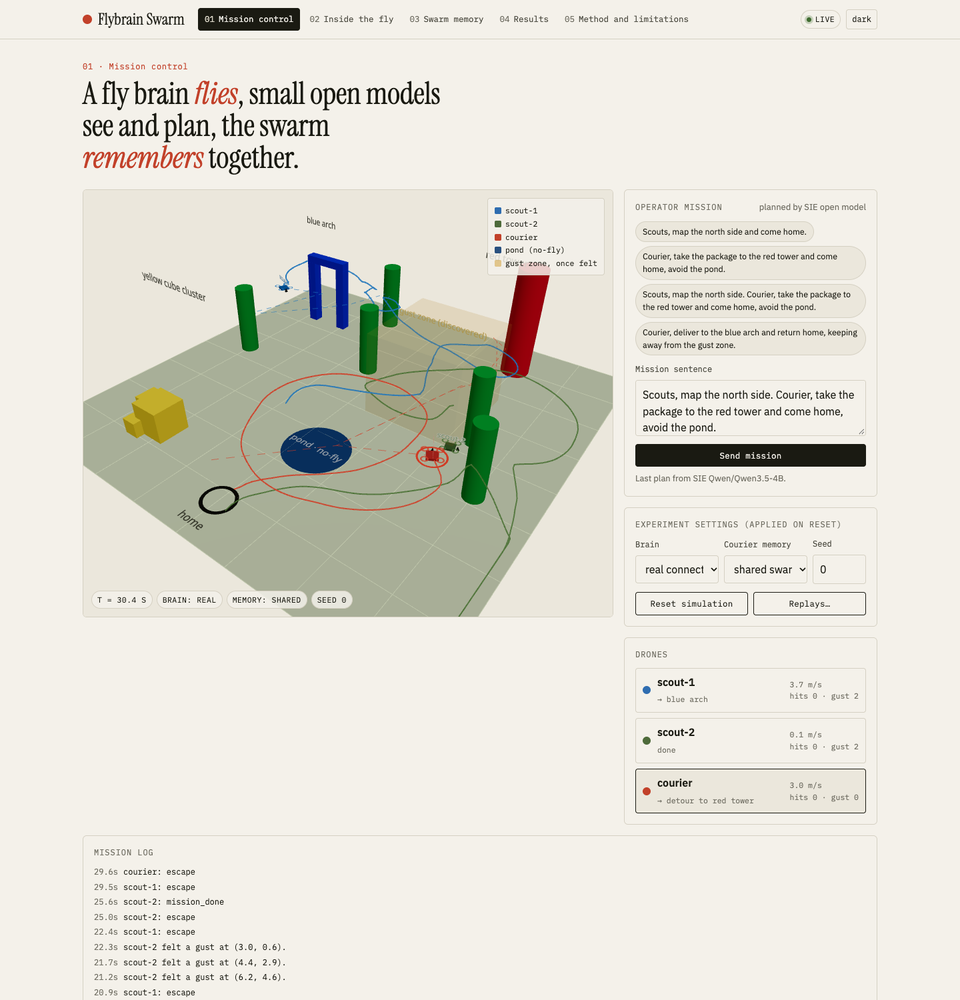
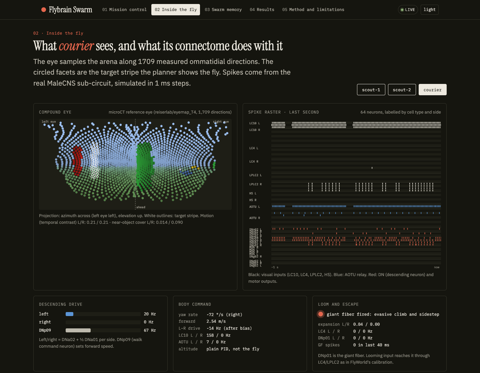
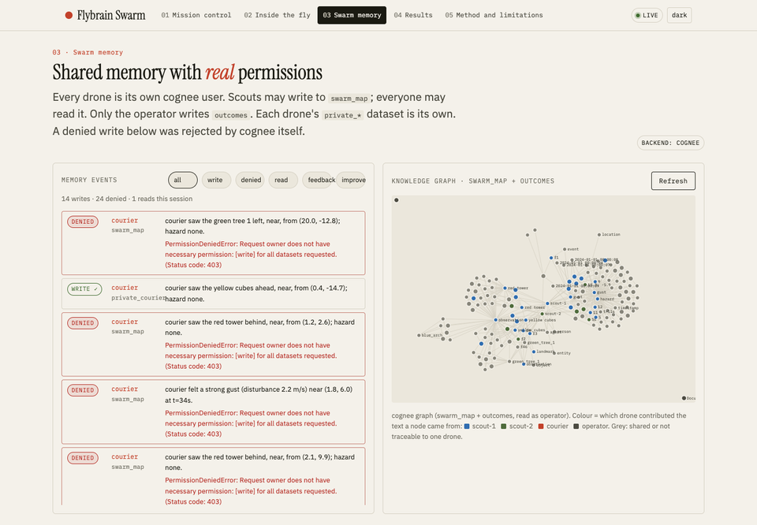
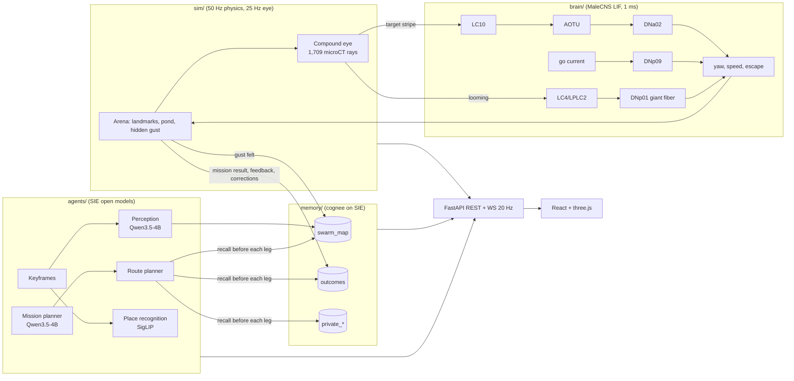
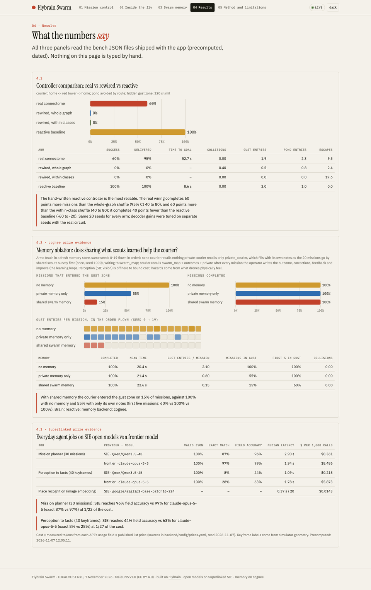

# Flybrain Swarm

*A fly brain flies, small open models see and plan, and the swarm remembers together.*

**Live app: https://flybrain-swarm.onrender.com** · Built on top of the [Flybrain](https://flybrain-q2h5.onrender.com/) research site.

Three simulated drones (`scout-1`, `scout-2`, `courier`) fly an outdoor arena.
- **Vision and steering.** Each drone sees through a compound eye built from **1,709 measured ommatidial directions of a real fruit fly**. It is steered by a **10,203-neuron sensory-to-descending sub-circuit of the MaleCNS v1.0 connectome**, simulated as spiking (leaky integrate-and-fire) neurons in 1 ms steps.
- **Agent jobs.** The everyday jobs run on small open models through **Superlinked SIE Serverless**: turning an operator's sentence into a flight plan, turning what a drone sees into facts, and recognising places it has seen before. Their quality and cost are measured against a frontier model (Claude Opus 5.5).
- **Shared memory.** The drones share what they learn through **cognee**. Every drone is its own cognee user with real read/write permissions. After every mission, outcomes, feedback and corrections flow back into memory.
- **Honest controls.** Every experiment has controls: two rewired connectomes and a hand-written reactive controller, all flown on the same seeds. Results are reported as measured, including where the fly brain loses.



---

## Findings at a glance

| Question | Answer (measured; full tables below) |
|---|---|
| Does shared memory help? *(cognee)* | **Yes.** The courier flew into the hidden gust zone on **100%** of missions with no memory, **55%** with only its own notes, and **15%** with the scouts' shared memory. It never entered after mission 3. The detour costs about 2 s per mission (22.6 s vs 20.4 s). |
| Can small open models do the everyday jobs? *(Superlinked)* | **For planning, yes.** SIE `Qwen/Qwen3.5-4B` produced the exact gold flight plan on **87%** of 30 missions (96% of fields right), against **97%** for `claude-opus-5-5`, at **1/23 of the cost** ($0.36 vs $8.49 per 1,000 calls). **For perception, neither model is good** on 128×64 eye panoramas (exact match 8% vs 28%), and we say so. |
| Is the real wiring doing the steering? | **It steers; the shuffles do not.** The real connectome completed **60%** of courier missions (it delivered on 95%). Both degree-preserving rewired graphs completed **0%**. A hand-written reactive controller completed **100%**: the fly brain is not the best controller, and the app says so. |
| Why do the rewired brains fail? | The real wiring has an **ipsilateral pursuit pathway**: target on the left → LC10 → AOTU → DNa02 on the left → turn left. In the class-preserving shuffle that pathway is **mirrored** (AOTU left drives DNa02 *right*), so the drone turns away from its target. The whole-graph shuffle either does nothing or excites every descending neuron at once. |

---

## Where Superlinked and cognee come in

| Integration | What to look at |
|---|---|
| **cognee**: agents share what they learn between each other | `backend/memory/store.py`: one cognee user per drone plus `operator`. Datasets `private_<drone>` (only that drone), `swarm_map` (scouts write, everyone reads) and `outcomes` (only the operator writes, everyone reads). A write without permission is rejected by **cognee itself** (`PermissionDeniedError`, HTTP 403) and shows up red in the Swarm memory feed. The learning loop is `backend/agents/swarm.py` → `finish_mission`, `_correct_hazards`: outcome written, wrong hazards corrected, session feedback scored, `cognee.improve()` run. The ablation is `backend/bench/memory_ablation.py`. |
| **Superlinked**: move an agent's everyday jobs off a frontier model onto SIE | `backend/models.yaml` (one line per job, swap in one line). `backend/agents/jobs.py`: planner and perception with strict JSON schemas, pydantic validation, one retry, then a loud failure. `backend/agents/llm.py`: measured tokens, latency and cost for SIE and for the frontier model. **cognee itself also runs on SIE** (LLM `Qwen/Qwen3.8-27B-FP8`, embeddings `BAAI/bge-m3`), so the whole memory stack is open models. The benchmark is `backend/bench/sie_bench.py`, with prices and sources in `backend/config/prices.yaml`. |

---

## The app, page by page

| Page | What you see |
|---|---|
| **01 Mission control** | A 3D arena (react-three-fiber). Drones with trails and dashed planned routes, landmarks (red tower, blue arch, yellow cubes, trees), the pond as a no-fly zone, and the gust zone, drawn only once a drone has felt it. There is a mission text box with examples, plus brain (real / rewired / class-rewired / reactive), memory mode and seed selectors. A **Live / Replay** badge shows which you are watching, and the mission log runs below. |
| **02 Inside the fly** | For the selected drone: the compound-eye mosaic (every facet at its measured direction, with the target stripe outlined), a one-second spike raster of 64 labelled neurons (LC10, LC4, LPLC2, HS, AOTU, DNa02, DNa01, DNp09, DNp01, MDN, DNg02), left and right descending-drive bars, yaw and speed readouts, and a giant-fiber escape lamp. |
| **03 Swarm memory** | A live feed of every memory event, with drone, dataset, **allowed or denied** and the text. Next to it is cognee's knowledge graph of `swarm_map` and `outcomes`, coloured by which drone contributed each node. |
| **04 Results** | Controller comparison, memory ablation and SIE vs frontier. Every number is read from the bench JSON files, each with a plain-English takeaway computed from the data. |
| **05 Method and limitations** | What the connectome controls and what is engineered, data sources, the controls, the circuit probe measured before the controller was built, and known limits. |

<p>


</p>

---

## How it works



### 1. Arena and drones (`backend/sim/`)
- **Arena.** 40 × 40 × 12 m, with a home pad, landmarks, and a pond marked as a no-fly zone. A **gust zone** (9 × 9 m, 2.1–3.1 m/s wind plus turbulence) sits between home and the red tower. No drone knows about it at the start.
- **Drones.** Kinematic quadrotors with velocity and yaw-rate commands and first-order drag, using 50 Hz physics and a 25 Hz control and eye loop. Collisions are counted, not fatal.
- **Gust sensing.** A drone notices a gust when its measured velocity departs from its own no-wind model of how it should respond, much as an IMU-based wind estimate would. Sharp turns and escapes therefore don't count as gusts.

### 2. Compound eye (`backend/sim/eye.py`)
- **Directions.** 1,709 microCT ommatidial directions (857 left, 852 right) from `reiserlab/eyemap_T4`. This is the same pinned, hash-checked file the owner's FlyVision project imports (`backend/scripts/prepare_eye.py`).
- **Ray casting.** Vectorised numpy rays against the arena primitives give per-facet colour, luminance and depth, in about 1 ms per frame.
- **Signals.** Motion (temporal contrast) and looming (expansion of near surfaces) are computed per eye.
- **Two renderings.** A hexagonal mosaic for the UI, and an equirectangular panorama for SIE vision and embedding models.

### 3. Connectome controller (`backend/brain/`)
- **Circuit.** The owner's FlyWorld sub-circuit, copied unchanged: 10,203 neurons and 401,680 signed edges with at least 5 synapses each.
- **Simulator.** FlyWorld's event-driven LIF: 1 ms steps, τ = 20 ms, threshold 1, 2 ms refractory, weight = synapse count × transmitter sign × 0.005.
- **Inputs (retinotopic by eye).**
  - The target stripe drives **LC10** on that eye's side.
  - Near-object expansion drives **LC4, LC6** (expansion rate) and **LPLC2, LC16** (size while expanding).
  - Temporal contrast drives **HS**.
- **Outputs (FlyWorld's decoder).**
  - Turning = (DNa02 + ½ DNa01) right minus left, after removing the walk-coupled bias. That bias is re-measured for each wiring with the same procedure.
  - Forward speed = DNp09 rate.
  - Escape = DNp01 (giant fiber) spikes, which trigger a climb and a sidestep away from the threat.
- **Not the fly.** Altitude is a plain PID, and a constant "go" current on DNp09 stands in for FlyWorld's walk button.
- **Controls, all on the same seeds.**
  - `rewired`: targets shuffled across the whole graph, keeping every neuron's in- and out-degree and its outgoing signed weights.
  - `rewired_class`: targets shuffled only within superclass × side block pairs (the style of the owner's Project 08 control).
  - `reactive`: a hand-written steer-to-target with obstacle repulsion from the same eye.

### 4. Everyday agent jobs on SIE (`backend/agents/`)
- **Mission planner** (`Qwen/Qwen3.5-4B`). Operator sentence → strict JSON plan: per drone, ordered goals (landmark plus action), constraints and a return-home flag. The plan is validated with pydantic, retried once, and the job fails loudly if the retry is invalid too. A visibility-graph route planner then turns goals into waypoints around the pond, landmarks and remembered hazards.
- **Perception to facts** (`Qwen/Qwen3.5-4B`, vision). Every 2 s or on a new landmark, the eye panorama plus the drone's pose become `{landmark, bearing, approx_distance, hazard}`, which is written to memory.
- **Place recognition** (`google/siglip2-base-patch16-224`). Keyframe embeddings are compared with the drone's earlier ones, and a match shows as "I have seen this place before" with the distance between the two poses.

### 5. Shared swarm memory on cognee (`backend/memory/`, `backend/agents/swarm.py`)
- **Multi-user.** Backend access control is on. There are four cognee users (`operator`, `scout-1`, `scout-2`, `courier`), and datasets are shared by id with `give_permission_on_dataset`.
- **Write path.**
  - When a scout feels a gust, it writes the sentence plus a machine-readable tag (`[fact kind=hazard hazard=gust x=… y=… r=…]`) to `swarm_map`.
  - When the courier tries the same, cognee rejects it with a 403, and the note goes to `private_courier`.
- **Read path.** Before each leg, the courier recalls from `swarm_map`, `outcomes` and its private notes:
  - CHUNKS returns the exact facts.
  - A hazard-only recall filtered by cognee node set keeps routine observations from crowding out gusts.
  - GRAPH_COMPLETION gives a natural-language answer, shown in the log.
  - Gust reports are clustered into area hazards that the route planner avoids.
- **Learning loop.** After each mission the operator:
  1. writes the outcome (success, time, route, gust entries, collisions, why it failed) to `outcomes`;
  2. writes a **correction** for any remembered hazard the courier flew through without feeling;
  3. scores the courier's recall session with `cognee.session.add_feedback`;
  4. runs `cognee.improve()`.

### 6. API and replays (`backend/api/server.py`)
- **WebSocket.** `WS /ws/sim` streams at 20 Hz: drone poses, goals, the eye mosaic, a spike-raster window, descending-neuron readouts, and memory and log events.
- **REST.** `POST /api/missions`, `POST /api/sim/reset`, `GET /api/bench/{sie,controllers,memory,probe}`, `GET /api/memory/graph`, `GET /healthz`.
- **Replay mode.** Runs are recorded to JSON (`backend/replays/`) and served by `/api/replays`, so the app still works if the live sim is slow.

### 7. A mission, step by step

This is what happens in a typical two-mission run (also recorded as `backend/replays/1-scouts-map-north.json` and `2-courier-uses-shared-memory.json`).

1. **Operator speaks.** *"Scouts, map the north side and come home."* goes to `POST /api/missions`. The SIE planner returns a JSON plan, which pydantic validates: `scout-1` and `scout-2` each get ordered landmark goals and `return_home: true`.
2. **Route.** For each leg, the drone first recalls memory (empty at this point). The visibility-graph router then builds waypoints around the pond, the landmarks and any remembered hazards.
3. **Fly.** Every 40 ms the current target is drawn as a bright stripe in that drone's eye, and the eye drives the connectome:
   - LC10 on the stripe's side → AOTU → DNa02 on the same side → the drone yaws toward the target;
   - DNp09 sets speed;
   - a looming tree fires LC4/LPLC2 → DNp01, and the drone climbs and sidesteps.
4. **Feel the gust.** Crossing the hidden gust zone, a scout's measured velocity departs from its no-wind model, and it writes `"Strong gust felt near (5.1, 3.0) … [fact kind=hazard hazard=gust x=5.1 y=3.0 r=2.5]"` to `swarm_map`. Reports are spaced at least 2.5 m apart.
5. **See and remember.** Every 2 s, SIE perception turns the eye panorama into a fact (landmark, bearing, distance, hazard). SigLIP embeddings flag places the drone has seen before (cosine similarity above 0.985).
6. **Courier's turn.** *"Courier, take the package to the red tower and come home, avoid the pond."* Before each leg the courier recalls from `swarm_map`, `outcomes` and `private_courier`:
   - the gust facts are clustered into one hazard circle;
   - the route bends around it;
   - the log shows cognee's GRAPH_COMPLETION answer ("a scout reported a strong gust between home and the red tower…").
7. **Denied write.** The courier tries to share its own observations to `swarm_map`. cognee raises `PermissionDeniedError`, the event shows red in Swarm memory, and the note is written to `private_courier` instead.
8. **Learn.** On landing, the operator:
   - writes the outcome to `outcomes`;
   - corrects any remembered hazard the courier crossed without feeling;
   - scores the recall session with `add_feedback`;
   - runs `cognee.improve()`.

   The next mission starts from that improved memory.

### 8. Memory permissions

Enforced by cognee's backend access control. `backend/memory/store.py` mirrors the same table so the local fallback behaves identically, and the tests check it.

| dataset | owner | read | write |
|---|---|---|---|
| `swarm_map` | operator | operator, scout-1, scout-2, courier | scout-1, scout-2 |
| `outcomes` | operator | everyone | operator |
| `private_scout-1` / `private_scout-2` / `private_courier` | that drone | that drone | that drone |

### 9. Neurons you will see

| neuron | role here |
|---|---|
| **LC10** | Lobula columnar visual projection neurons. Tuned to small moving objects; driven by the target stripe on their eye's side. |
| **AOTU** | Anterior optic tubercle neurons. Relay LC10 to the descending neurons. |
| **DNa02 / DNa01** | Descending neurons for steering. Left minus right firing gives the yaw rate. |
| **DNp09** | A descending "walk forward" command neuron. Its firing rate sets speed; it receives a constant "go" current during a mission. |
| **LC4, LC6, LPLC2, LC16** | Looming detectors, driven by near objects expanding in the eye. |
| **DNp01** | The giant fiber. Its spikes trigger an escape: climb and sidestep away from the threat. |
| **HS** | Horizontal system cells, wide-field motion. Driven by temporal contrast. |
| **MDN, DNg02** | Moonwalker (backward) and flight-power descending neurons. Shown in the raster for context; not used for control. |

### 10. API reference

| method | path | what it does |
|---|---|---|
| `WS` | `/ws/sim` | 20 Hz frames: drones, goals, routes, eye mosaic of the selected drone, raster window, DN readouts, memory and log events |
| `POST` | `/api/missions` | `{"text": "..."}` (max 500 chars) → `{plan, source}`; starts the mission |
| `POST` | `/api/sim/reset` | `{"seed", "brain", "memory_mode"}`. `brain` is `real`, `rewired`, `rewired_class` or `reactive`; `memory_mode` is `none`, `private` or `shared` |
| `POST` | `/api/sim/save_replay` | record the current run to `backend/replays/` |
| `GET` | `/api/replays`, `/api/replays/{name}` | list and fetch recorded runs |
| `GET` | `/api/bench/{sie,controllers,memory,probe}` | benchmark results (the same JSON the README tables come from) |
| `GET` | `/api/memory/graph`, `/api/memory/events` | cognee knowledge graph of the shared datasets; last 200 memory events |
| `GET` | `/api/arena`, `/api/eye/layout` | arena geometry; the 1,709 eye directions |
| `GET` | `/api/status`, `/healthz` | models, memory backend, current seed/brain, turn-bias calibration; health |

### 11. Tech stack

| layer | what |
|---|---|
| Simulation | Python 3.12, numpy (ray casting, physics), torch CPU (batched LIF over 10,203 neurons for all drones at once) |
| Agents | `sie-sdk` 0.11.0 (chat completions with JSON-schema output, image inputs, `encode` for SigLIP), `anthropic` 2.6.0 for the frontier comparison, pydantic |
| Memory | cognee 1.6.7 with backend access control, custom LLM provider pointed at SIE `/v1`, `openai_compatible` embeddings |
| API | FastAPI, uvicorn, WebSocket |
| Frontend | React 18.3.1, Vite 5.4.10, TypeScript 5.6, three 0.169 + @react-three/fiber 8.17 + drei 9.114, d3-force 3 (memory graph) |
| Deploy | Multi-stage Docker (Node build → Python runtime) on Render Standard |

---

## Results

All numbers below are generated from `backend/bench/results/*.json` by `python -m backend.scripts.readme_tables`. Nothing is typed by hand. The app's Results page reads the same files.



<!-- RESULTS:START -->

### Controllers (real vs rewired vs reactive)

Task: courier: home -> red tower -> home; pond avoided by route; hidden gust zone; 120 s limit. Seeds 0–19 for every arm (tuning seeds [100, 101, 102] excluded). Generated 2026-11-07 12:40:26.

| arm | success | delivered | time to goal (s) | collisions | gust entries | pond entries | escapes |
|---|---:|---:|---:|---:|---:|---:|---:|
| real connectome | 60% | 95% | 52.7 | 0.00 | 1.9 | 2.3 | 9.5 |
| rewired, whole graph | 0% | 0% | – | 0.40 | 0.5 | 0.8 | 2.4 |
| rewired, within classes | 0% | 0% | – | 0.00 | 0.0 | 0.0 | 17.6 |
| reactive baseline | 100% | 100% | 8.6 | 0.00 | 2.0 | 1.0 | 0.0 |

real minus rewired: success difference +0.60 (95% paired bootstrap CI +0.40 to +0.80).

real minus rewired class: success difference +0.60 (95% paired bootstrap CI +0.40 to +0.80).

real minus reactive: success difference -0.40 (95% paired bootstrap CI -0.60 to -0.20).

### Memory ablation (cognee)

Brain: reactive. Memory backend: cognee. Seeds 0–19 flown in order. Generated 2026-11-07 13:14:47.

| courier memory | completed | mean time (s) | gust entries / mission | missions entering gust | first 5 missions entering gust | collisions |
|---|---:|---:|---:|---:|---:|---:|
| no memory | 100% | 20.4 | 2.10 | 100% | 100% | 0.00 |
| private memory only | 100% | 21.4 | 0.60 | 55% | 100% | 0.00 |
| shared swarm memory | 100% | 22.6 | 0.15 | 15% | 60% | 0.00 |

Memory events per arm (writes / reads / denied / feedback / improve / errors): none: 136/0/116/20/20/0; private: 39/80/11/20/20/0; shared: 36/80/4/20/21/0.

### SIE vs frontier (Superlinked)

30 missions with hand-written gold plans; 40 keyframes labelled from simulator geometry. Generated 2026-11-07 12:05:11.

| job | provider | model | valid JSON | exact match | field accuracy | median latency (s) | $ per 1,000 calls |
|---|---|---|---:|---:|---:|---:|---:|
| mission planner | sie | `Qwen/Qwen3.5-4B` | 100% | 87% | 96% | 2.90 | $0.361 |
| mission planner | frontier | `claude-opus-5-5` | 100% | 97% | 99% | 1.94 | $8.486 |
| perception to facts | sie | `Qwen/Qwen3.5-4B` | 100% | 8% | 44% | 1.09 | $0.215 |
| perception to facts | frontier | `claude-opus-5-5` | 100% | 28% | 62% | 1.78 | $5.873 |
| place recognition | sie | `google/siglip2-base-patch16-224` | – | – | – | 0.37 per 20 images | $0.0143 per 1,000 images |

<!-- RESULTS:END -->

**How to read these.**
- **Controllers.** Seeds 0–19, with decoder gains tuned beforehand on separate seeds (100–102) using the real circuit, which if anything favours the real circuit. Intervals are 95% paired bootstrap intervals over seeds.
- **Memory ablation.** It uses the reactive brain, to isolate the effect of memory from the fly controller's own variability. The 20 missions in each arm are flown in order so learning across missions is visible. Every arm ran on real cognee with 0 memory errors.
- **SIE benchmark.** Gold plans are hand-written (`backend/bench/missions.jsonl`). Keyframe labels come from simulator geometry. Cost is measured tokens × published list price.

---

## Repository layout

```
fly_superlinked/
  backend/
    sim/        arena.py (landmarks, pond, gust), eye.py (1,709-ray compound eye), world.py (drones, physics, sensing)
    brain/      circuit.py (MaleCNS sub-circuit, rewired controls), lif.py (LIF simulator), controller.py (eye -> circuit -> command, reactive baseline)
    agents/     jobs.py (planner, perception), llm.py (SIE / frontier calls, cost), route.py (visibility-graph router), swarm.py (missions, memory, learning loop)
    memory/     store.py (cognee multi-user memory, permissions, local fallback)
    api/        server.py (REST, WebSocket, replays, serves the built frontend)
    bench/      probe_circuit.py, controllers.py, sie_bench.py, memory_ablation.py, missions.jsonl, keyframes/, results/
    scripts/    prepare_eye.py, readme_tables.py, verify.py
    tests/      plan schema, permission rules, degree-preserving rewiring
    replays/    recorded runs
    models.yaml one line per agent job
    config/prices.yaml  published prices with sources
  frontend/     React + Vite + TypeScript + react-three-fiber (five pages)
  Dockerfile, requirements.txt, ../render.yaml
  NOTES.md (what was reused from flybrain), LOG.md (build log), GATES.md (completion checks)
```

---

## How to run locally

```bash
cd fly_superlinked
python3.12 -m venv .venv
.venv/bin/pip install torch==2.15.0 --index-url https://download.pytorch.org/whl/cpu
.venv/bin/pip install -r requirements.txt && .venv/bin/pip install --no-deps sie-sdk==0.11.0
cp .env.example .env            # add SIE_API_KEY (and optionally FRONTIER_API_KEY)
cd frontend && npm ci && npm run build && cd ..
.venv/bin/uvicorn backend.api.server:app --port 8000      # open http://localhost:8000
# frontend dev server with hot reload: cd frontend && npm run dev  -> http://localhost:5173
```

To try it, send *"Scouts, map the north side and come home."* first, then *"Courier, take the package to the red tower and come home, avoid the pond."* The courier then plans around the gust the scouts found.

Tests: `.venv/bin/pytest -q` (23 tests). They cover the JSON plan schema, the permission rules (a drone cannot write where it lacks write permission), and both rewired shuffles preserving degree.

Re-run every experiment:

```bash
.venv/bin/python -m backend.bench.probe_circuit           # circuit probe used to design the eye -> circuit mapping
.venv/bin/python -m backend.bench.controllers             # real vs rewired vs rewired_class vs reactive, seeds 0-19
.venv/bin/python -m backend.bench.sie_bench               # SIE vs frontier: 30 missions, 40 keyframes
for a in shared private none; do .venv/bin/python -m backend.bench.memory_ablation $a reactive; done
.venv/bin/python -m backend.bench.memory_ablation merge reactive
.venv/bin/python -m backend.scripts.readme_tables         # refresh the tables in this README
```

### Environment variables

| Variable | Needed | Meaning |
|---|---|---|
| `SIE_API_KEY` | yes, for SIE jobs and cognee | Superlinked SIE Serverless key. Without it the app runs with a keyword fallback planner and a local permissioned memory, and the UI says so. |
| `SIE_BASE_URL` | no | defaults to `https://api.superlinked.com` |
| `FRONTIER_PROVIDER`, `FRONTIER_API_KEY` | no | frontier comparison: `anthropic` (default model `claude-opus-5-5`) or `openai_compatible` (`FRONTIER_BASE_URL`, `FRONTIER_MODEL`, `FRONTIER_PRICE_IN/OUT`) |
| `DATA_DIR` | no | where cognee keeps its stores (default `fly_superlinked/var`) |
| `MEMORY_BACKEND` | no | `cognee` (default when an SIE key exists) or `local` |

---

## Deploy on Render

- **Blueprint.** `render.yaml` at the repository root defines one Docker web service. A multi-stage `Dockerfile` builds the frontend with Node, then serves it from FastAPI together with the API and WebSocket on `$PORT`. The health check is `/healthz`.
- **Secrets.** Set `SIE_API_KEY` and `FRONTIER_API_KEY` in the dashboard.
- **Plan.** Use **Standard** (2 GB). On Starter (512 MB) the service kept restarting under torch, cognee and three simulated brains.
- **Live service and its memory.** The live service was created with the Render CLI, which cannot attach disks. It keeps cognee's stores in `/tmp/swarm-data`, so live memory starts fresh after each deploy. Bench results and replays ship in the repo, so the Results page and Replay mode are always complete.
- **Dependency pin.** `sie-sdk` 0.11.0 pins `websockets<15`, while cognee needs `>=15.0.1`. sie-sdk works on 15 (every SIE call in the benchmarks ran on it), so the Dockerfile installs it with `--no-deps`.

---

## Troubleshooting

| symptom | cause and fix |
|---|---|
| Status shows `memory: local` instead of `cognee` | No `SIE_API_KEY`, or cognee setup failed three times at startup (the server retries). Check the key in `.env` and restart. The local backend enforces the same permissions. |
| Mission card says "planned by keyword fallback" | No `SIE_API_KEY` is set, so a simple keyword planner is used. Add the key and restart. |
| `502 planner failed` when sending a mission | SIE was reachable but returned an invalid plan twice. The job fails loudly by design rather than flying a bad plan; resend or rephrase. |
| Live sim is slow or stutters on Render | Three spiking brains, cognee and SIE calls share one instance. Switch to **Replay** on Mission control, or run locally. |
| `pip` complains about `websockets` | `sie-sdk` pins `websockets<15` but cognee needs 15+. Install sie-sdk with `--no-deps` as shown above. |
| Live memory is empty after a deploy | The Render service keeps cognee stores in `/tmp`. Run the scouts' mission first to repopulate the map. |

---

## Method and limitations

- **Controlled by the circuit:** turning (DNa02/DNa01, left minus right), forward speed (DNp09 rate) and escape (DNp01 giant fiber).
- **Engineered:** altitude (PID), the walk "go" current, target choice and routing, the decoder gains (tuned on seeds 100–102, then frozen), and gust sensing.
- **Thin left input.** The sub-circuit has 3 left LC10 cells and 27 right ones, an artefact of how FlyWorld extracted it. Left turns are therefore weak, and the real circuit reaches targets with right-handed loops.
- **Not the owner's steering circuit.** Project 08's 443-neuron LC10a → AOTU → DN graph is not in the flybrain repo. This uses the same pathway as it exists inside the FlyWorld subset.
- **No training.** The owner's Project 08 found rewired ≈ real for *trained* controllers. Nothing here is trained, so the real-vs-rewired gap measures the built-in pathways, which is a different question. The rewired graphs are not activity-matched.
- **Perception labels.** Keyframes are labelled from simulator geometry. Distance classes are thresholds on depth, and both models find them hard.
- **Eye registration.** The eye geometry comes from a female specimen and is not registered to MaleCNS photoreceptors. The eye-to-LC10 mapping is retinotopic by side only.
- **Bugs fixed before the final runs.** Running the experiments surfaced several bugs, listed in `LOG.md`: a rewiring swap bug, unreachable tree goals, a too-timid reactive baseline, gust false positives from turns, and hazard recall being crowded out. All were fixed before the final runs, and every arm was rerun on identical code.

## Data and credits

MaleCNS v1.0 (Berg et al., *Cell*, 2026; FlyEM at HHMI Janelia, University of Cambridge, MRC LMB, Google Research; CC BY 4.0). Eye directions from `reiserlab/eyemap_T4` (pinned commit). FlyWorld circuit, LIF simulator and decoder from `prove-ai/flybrain`; `NOTES.md` lists exactly what was reused. Open models served by Superlinked SIE; memory by cognee.
